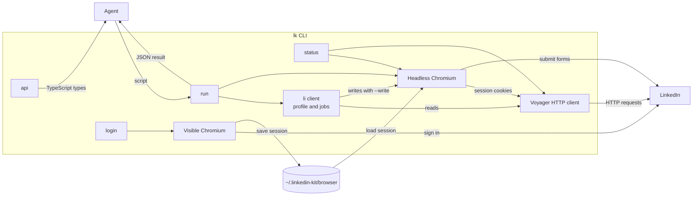

# linkedin-kit

The `lk` CLI runs short TypeScript scripts with a typed `li` client and returns JSON.

## What it does

- Read and edit your LinkedIn profile, including your headline, About section, location, experience, education, and skills.
- Search jobs, read job details, and list saved jobs.

The kit does not apply to jobs or run an MCP server.

## Use with an agent

Give any agent with shell access the [LinkedIn skill](skills/linkedin/SKILL.md) and the scripts in [examples/](examples/). The agent reads the API with `lk api`, writes a script, and runs it with `lk run`. The agent can use the results to compare jobs with your profile.

Automated access breaks LinkedIn's User Agreement. LinkedIn can restrict your account. Keep request volume low and avoid bulk actions.

## Setup

```sh
bun install
bunx patchright install chromium
bun src/cli.ts login    # sign in once in the browser window that opens
bun src/cli.ts status   # check the saved session
```

From a checkout, use `bun src/cli.ts` in place of `lk` in the commands below.

## Commands

- `lk login` opens a visible Chromium window for a one-time sign-in and saves the session. Run it again if the session expires.
- `lk status` checks the saved session and shows who is signed in.
- `lk api` prints the type definitions of the `li` client without opening a browser.
- `lk run <file>` runs a script with `li` available and prints the result as JSON. `lk run -` reads the script from standard input.
- `lk run --write <file>` lets the script submit profile edits. Without `--write`, edit methods only return the current and proposed values.

An `lk run` script is an async function body: use `await` directly and `return`
a JSON-serializable value. The result goes to stdout (`null` if nothing is
returned); console output and errors go to stderr. Run only trusted scripts:
they run locally with your permissions, not in a sandbox.

```sh
printf 'return (await li.profile.get()).skills;\n' | lk run -
```

## Architecture

Bun runs TypeScript directly. `lk status` and `lk run` open headless Chromium in the background using the profile saved in `~/.linkedin-kit/browser`. There is no daemon. Only one session runs at a time, and a rate-limited queue runs LinkedIn operations in order.

Reads use plain HTTP requests to LinkedIn's internal Voyager JSON API with cookies from the browser session. Profile writes fill and submit LinkedIn's forms in headless Chromium.


