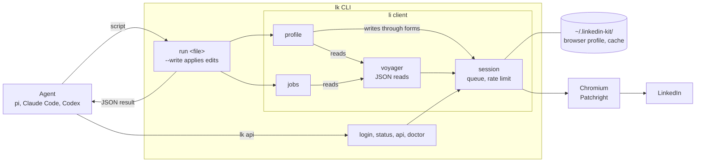

# linkedin-kit

Terminal + agent toolkit to edit a LinkedIn profile and apply to jobs.

The kit gives an agent a typed `li` client for LinkedIn. The agent writes a short TypeScript script against that client, and the `lk` CLI runs it. One script can search jobs, fetch their details in parallel, filter them, and return only what matters, so the agent's context stays small.

## What it will do

- Read your own profile: headline, about, experience, education, and skills.
- Edit your profile: headline, about, location, experience and education entries, and skills.
- Search jobs, read job details, and list saved jobs.
- Give an agent clean, structured data so that it can compare each job with your profile.

Applying to jobs and an MCP server are out of scope for the first version.

## How it works

The agent does not call one tool for each action. It reads the `li` API with `lk api`, writes a script, and runs it with `lk run`. The result comes back as JSON. This works with any agent that has a shell, for example pi, Claude Code, or Codex.

The agent does the comparison between your profile and a job itself. A skill file tells it how to write scripts, how to compare, and which rate limits to respect. The kit only supplies the data.

## Commands

- `lk login` opens a browser so that you can log in to LinkedIn. With `--import-from-browser`, it takes the session from your browser.
- `lk status` shows whether the session is valid.
- `lk api` prints the type definitions of the `li` client for the agent.
- `lk run <file>` runs an agent script with `li` available and prints the result as JSON. `lk run -` reads the script from standard input.
- `lk run --write <file>` also applies profile edits. Without `--write`, an edit is a dry run that shows the change.
- `lk doctor` checks on demand that LinkedIn's pages and endpoints still match what the kit expects.

## Architecture

`lk` is a CLI in TypeScript that runs on Bun, so scripts need no build step.

The `li` client has four parts:

- **Session.** One persistent Chromium profile, driven by Patchright. One session at a time, a sequential queue, and a rate limit.
- **Voyager.** Reads go through LinkedIn's internal JSON API with the browser session where possible, because it is fast and stable. The page content is the fallback.
- **Profile.** Get the profile, and add, edit, or delete its parts. Writes go through LinkedIn's own forms, because LinkedIn accepts member edits that way.
- **Jobs.** Search, get details, list saved jobs, and save or unsave a job.

Every write returns the profile before and after the change. It executes only under `lk run --write`.

The kit keeps its state in `~/.linkedin-kit/`: the browser profile and a cache of profile and job snapshots. There is no daemon. Each `lk run` opens the persistent browser context again.
